<div align="center">

# AI 小说生成器

[English](README.md) · **简体中文**

从一个故事想法出发，逐步完成设定、分卷、篇章、场景与正文。

[创作演示](#创作演示) · [安装与启动](#安装与启动) · [界面一览](#界面一览) · [备份与升级](#备份与升级)

</div>

这是一个在本机运行的小说创作工作台。你可以手工编写，也可以让 AI 协助生成，再审阅、修改并保存结果。人物、势力、关系和故事规划与正文放在同一个项目中，创作进度会提示下一步。

在项目开发期间的生成流程测试中，特别感谢 [LINUX DO 社区](https://linux.do/) 的佬友们提供公益站资源。


## 创作演示

以下片段展示了作品《潮汐档案》从新建到首章保存的全流程，均录自当前真实界面。**演示使用预设模型响应，仅展示操作流程，不代表模型质量。**

**01 · 新建小说：创意 → 故事方向 → 确认保存**

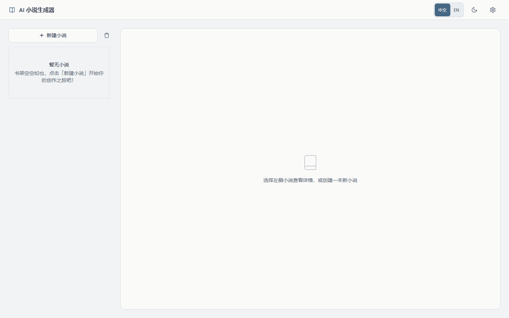

<details>
<summary><strong>02 · 核心资料：势力、角色与关系图谱</strong>（展开播放）</summary>

生成并保存核心资料，在图谱中查看人物关系与势力归属。

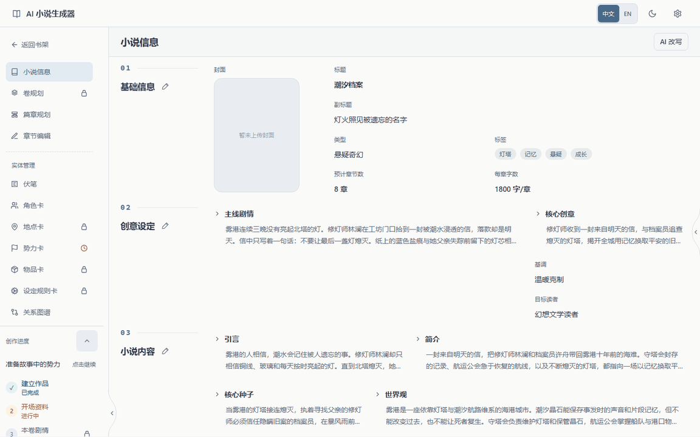

</details>

<details>
<summary><strong>03 · 逐层规划：卷 → 篇章 → 场景 → 章计划</strong>（展开播放）</summary>

规划全书分卷、展开当前卷并确认参与资料，再手工细化第一篇章、场景与章计划。本例跳过可选的规则、物品，确认本卷地点为空。

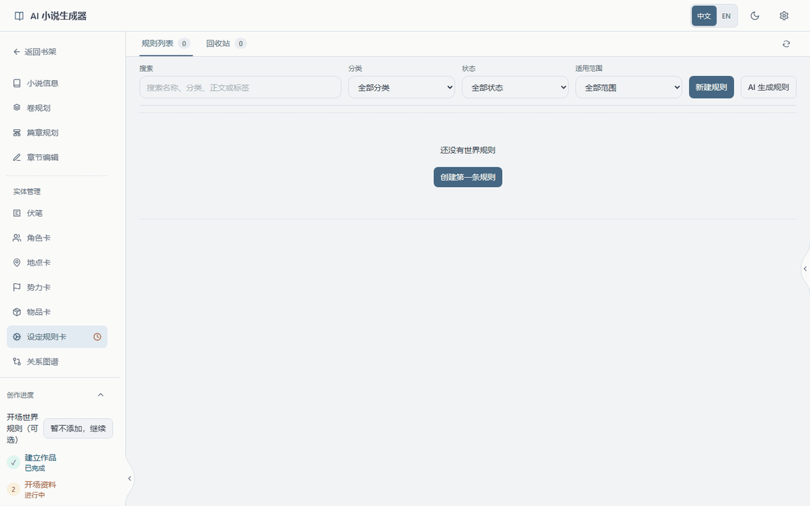

</details>

<details>
<summary><strong>04 · 写出第一章：生成 → 审阅 → 保存</strong>（展开播放）</summary>

基于已保存的章计划生成正文，确认候选并保存第一章。此处尚未完成整本小说。

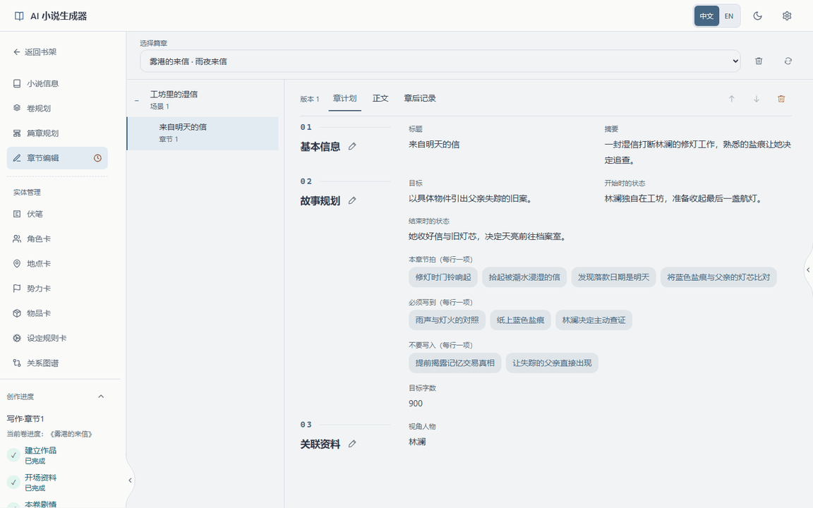

</details>

## 安装与启动

下面以 **Windows + PowerShell + Docker MongoDB** 为主线。安装过程需要联网下载依赖；AI 生成功能还需要自行配置可用的模型服务。

### 1. 准备环境与代码

安装 [Python 3.13](https://www.python.org/downloads/)、[Node.js 24](https://nodejs.org/en/download)、[Git](https://git-scm.com/downloads) 和 [Docker Desktop](https://docs.docker.com/desktop/setup/install/windows-install/)。启动 Docker Desktop，确认引擎正在运行；终端中 `python --version`、`node --version` 和 `docker compose version` 应能正常输出版本。前端要求 Node.js 至少 20.9。

```powershell
git clone https://github.com/YILING0013/AI_NovelGenerator.git
cd AI_NovelGenerator
python -m venv .venv
.\.venv\Scripts\python.exe -m pip install -r requirements.txt
cd frontend
npm ci
cd ..
```

### 2. 启动 MongoDB 副本集

篇章、章节等保存操作需要 MongoDB 多文档事务，因此必须使用**副本集**。项目自带的 [compose.mongodb.yaml](compose.mongodb.yaml) 使用 MongoDB 8.0，在本机 `127.0.0.1:27017` 提供单节点副本集 `rs0`。

先确认 `27017` 未被其他服务占用（Windows 可运行 `netstat -ano | findstr :27017`）。**如果已安装独立的 Windows MongoDB，不能直接与此 Docker 实例混用或重复启动。** 已有可写副本集可直接使用自己的连接地址；已有单机库应先备份，再单独规划转换或另设端口。不要为释放端口而删除数据卷或重建已有数据库。

在项目根目录运行：

```powershell
docker compose -f compose.mongodb.yaml up -d
docker compose -f compose.mongodb.yaml exec mongodb mongosh
```

**仅在首次使用全新数据卷时**，在进入的 MongoDB shell 中执行一次：

```javascript
rs.initiate({ _id: "rs0", members: [{ _id: 0, host: "localhost:27017" }] })
exit()
```

回到 PowerShell 检查：

```powershell
docker compose -f compose.mongodb.yaml ps
```

等待 `mongodb` 显示 **healthy**，表示它已成为可写主节点。未初始化时显示 unhealthy 并不意味着需要清空数据。后续启动只需 `up -d`，不要重复初始化已有副本集。

数据保存在命名卷 `novel-generator-mongodb-data` 与 `novel-generator-mongodb-config` 中。普通 `docker compose -f compose.mongodb.yaml stop` 只停止服务；**不要使用 `down -v` 删除这些数据卷**。

### 3. 启动应用并连接数据库

双击根目录 **`start.bat`**，在桌面启动器中启动前后端。它使用上一步安装的 `.venv`，生产模式会在首次启动或相关代码、配置变化后构建前端。`start.bat` 本身不安装依赖或数据库。

打开 **http://127.0.0.1:3300**，进入 **设置 → 数据库配置**。点击“替换连接”填写 URI 并确认，再填写数据库名，保存设置：

| 字段 | 本地 Docker 方案的值 |
| --- | --- |
| MongoDB URI | `mongodb://127.0.0.1:27017/?replicaSet=rs0&directConnection=true` |
| 数据库名 | `novel_generator` |

配置文件中的 `mongo_transaction_mode` 默认是 `required`，保持此值即可，无需为首次安装手工修改。

检查通过后即可创建小说。后端默认地址为 `http://127.0.0.1:8200`。端口冲突时先识别占用者，再在启动器中修改端口；关闭启动器会停止它启动的服务，MongoDB 由 Docker 单独管理。

### 4. 配置模型，开始创作

在 **设置 → LLM Provider 管理** 中添加服务类型、接口地址、API Key 和模型，启用并保存配置；再到 **小说生成流程配置** 选择全局默认 Provider 并保存。内置流程可直接作为起点，各节点也可单独指定模型。接口必须兼容所选适配器，实际支持的参数以服务商为准，调用费用由服务商计收。

新建小说后，沿左侧**创作进度**准备核心资料、规划卷及参与资料，再细化篇章、场景和章计划。生成结果先审阅再保存；正文也可以直接手写。章后记录可用于核对人物、关系、物品及规则的变化。

<details>
<summary><strong>命令行启动（含 macOS / Linux）</strong></summary>

安装同样的依赖并准备好副本集。macOS / Linux 用 `python3 -m venv .venv` 创建环境，之后使用 `.venv/bin/python`，无需运行 Windows 的 `start.bat`。

在项目根目录启动后端：

```powershell
.\.venv\Scripts\python.exe main.py
```

另开一个 PowerShell 终端启动前端：

```powershell
cd frontend
$env:NEXT_PUBLIC_API_BASE = "http://127.0.0.1:8200"
npm run build
npm run start -- --hostname 127.0.0.1 --port 3300
```

macOS / Linux 中对应环境变量命令为 `export NEXT_PUBLIC_API_BASE="http://127.0.0.1:8200"`。地址须在构建前设置，修改后重新构建。开发时可用 `npm run dev -- --hostname 127.0.0.1 --port 3300`。

`NOVEL_GENERATOR_BACKEND_PORT` 可修改后端监听端口；数据库可通过 `NOVEL_GENERATOR_MONGODB_URL`、`NOVEL_GENERATOR_MONGO_DATABASE_NAME` 覆盖配置。手工编辑配置文件后重启后端。

</details>

## 界面一览

**人物与势力关系图谱**将角色关系、势力关系和归属放在同一张图中，可筛选、缩放、拖动节点并查看详情。

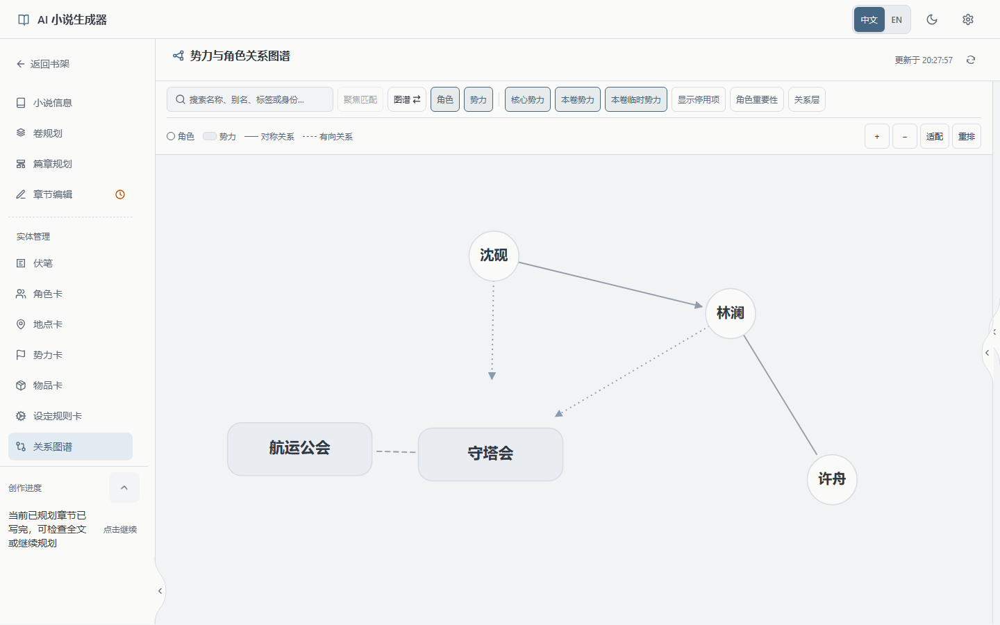

<details>
<summary><strong>故事、角色、卷规划与正文编辑</strong></summary>

小说信息集中管理故事方向、世界观、风格与篇幅；角色资料支持按故事位置查看。规划从卷逐层展开，正文编辑提供字数统计、保存、草稿导出和历史版本。

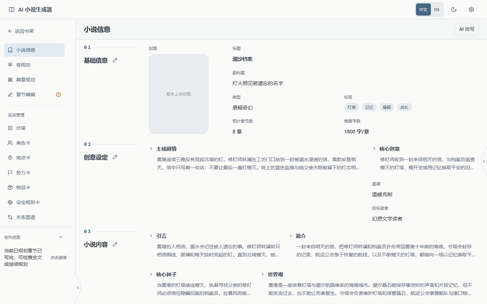
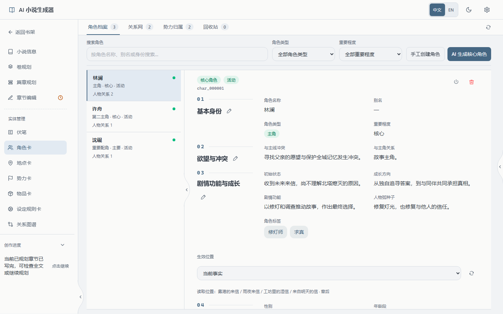
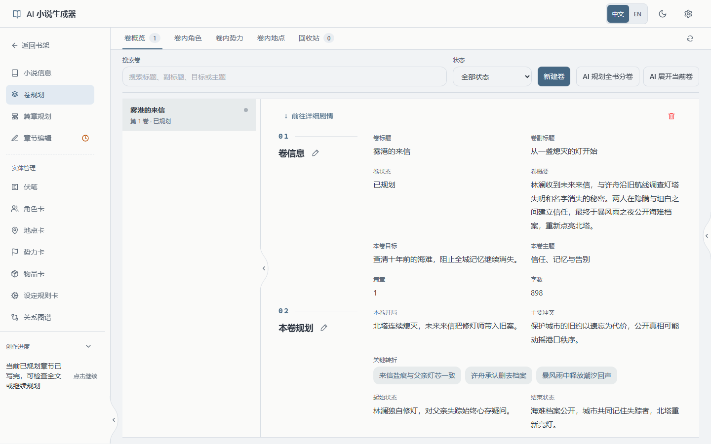
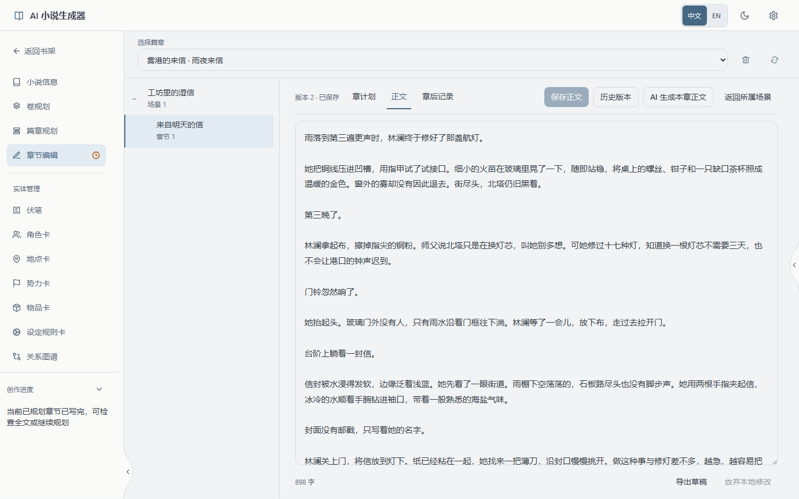

</details>

<details>
<summary><strong>可编辑的 AI 流程与提示词</strong></summary>

内置流程覆盖新建小说、资料生成、各层规划、正文与章后检查。可在画布中调整节点及连线，修改提示词、输入输出与模型配置；无需先自建流程才能开始写作。

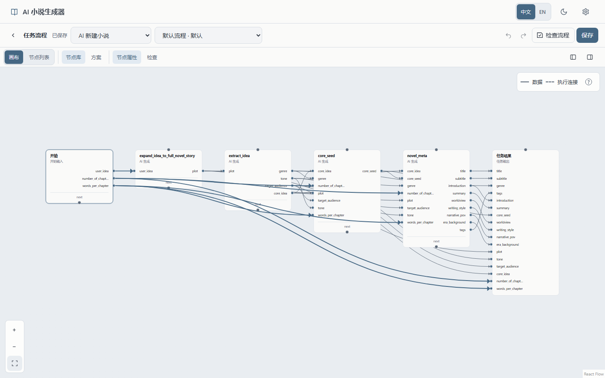
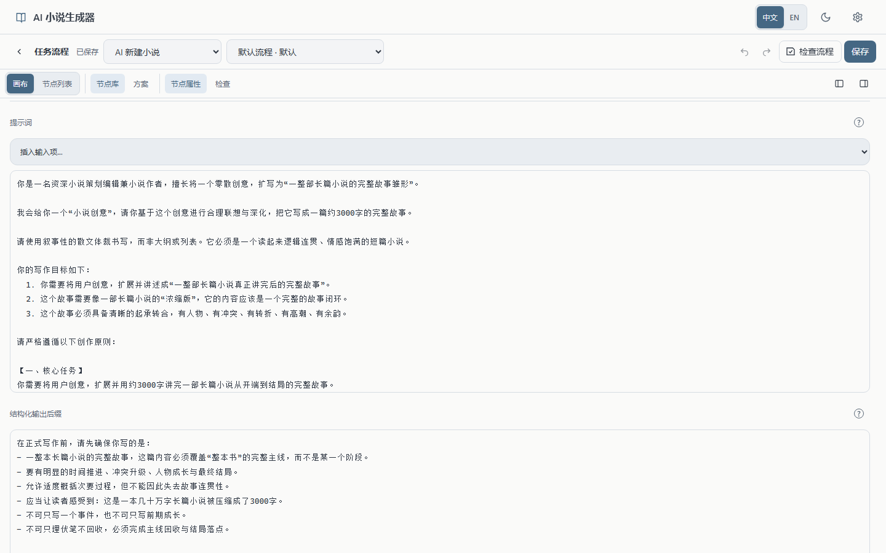

</details>

界面支持中英文、浅色/深色主题与响应式布局；此处展示桌面中文界面。技术栈为 Next.js 16、React 19、HeroUI、React Flow、FastAPI、PyMongo 与 PySide6。

## 备份与升级

当前 `main` 是重写版，旧版保留在 [`old`](https://github.com/YILING0013/AI_NovelGenerator/tree/old)。两者数据结构不同，请使用独立数据库。新版书籍归档格式为 v14，旧程序无法读取新版归档。

| 数据 | 保存位置 |
| --- | --- |
| 小说、角色、规划、正文及写作记录 | 配置指定的 MongoDB 数据库 |
| 数据库和模型配置（含密钥） | `user_data/config/config.yaml` |
| 自定义流程、上传封面 | `user_data/task_flows/`、`user_data/static/` |
| 导出、迁移备份与记录 | `user_data/exports/`、`user_data/backups/`、`user_data/migrations/` |
| 启动器端口设置 | `user_data/config/launcher_settings.json` |
| 未保存正文草稿 | 当前浏览器、当前站点地址的本地存储 |

默认用户目录是项目下的 `user_data/`，可用 `NOVEL_GENERATOR_USER_DATA_DIR` 指定独立目录。

- **更新前**确认保存结果、导出未保存草稿，停止应用并分别备份 MongoDB 与用户文件。复制 `user_data` 或导出单本书都不是完整备份。然后自行更新代码、重新安装依赖并构建前端。
- **启动时**仅迁移受支持的旧文件目录与数据。可识别且未修改、使用最新默认修订的内置流程会备份后升级；自定义或固定旧修订的流程会保留。程序不会安装 MongoDB、自动下载代码，也不会转换任意历史版本的数据库。
- **迁移失败时**保留原文件、备份与迁移记录，按错误提示处理冲突；不要删除 `user_data` 或数据库来重试。生成恢复依赖原后端进程和页面，刷新或重启不保证恢复，重试模型调用可能再次计费。

本项目面向本机使用，应用没有面向公网的用户认证；自带 MongoDB 也未设置密码，仅绑定回环地址。请勿直接暴露到公网。AI 操作会将所需故事上下文发送给你配置的模型服务。

## 反馈与参与

遇到问题请提交 [Issue](https://github.com/YILING0013/AI_NovelGenerator/issues/new/choose)，附版本、环境、复现步骤及脱敏后的截图或日志。参与开发请先阅读[贡献指南](.github/CONTRIBUTING.md)。项目采用 [GNU AGPL v3.0](LICENSE)。

## Star History

[](https://www.star-history.com/?repos=YILING0013%2FAI_NovelGenerator&type=date&legend=top-left)
